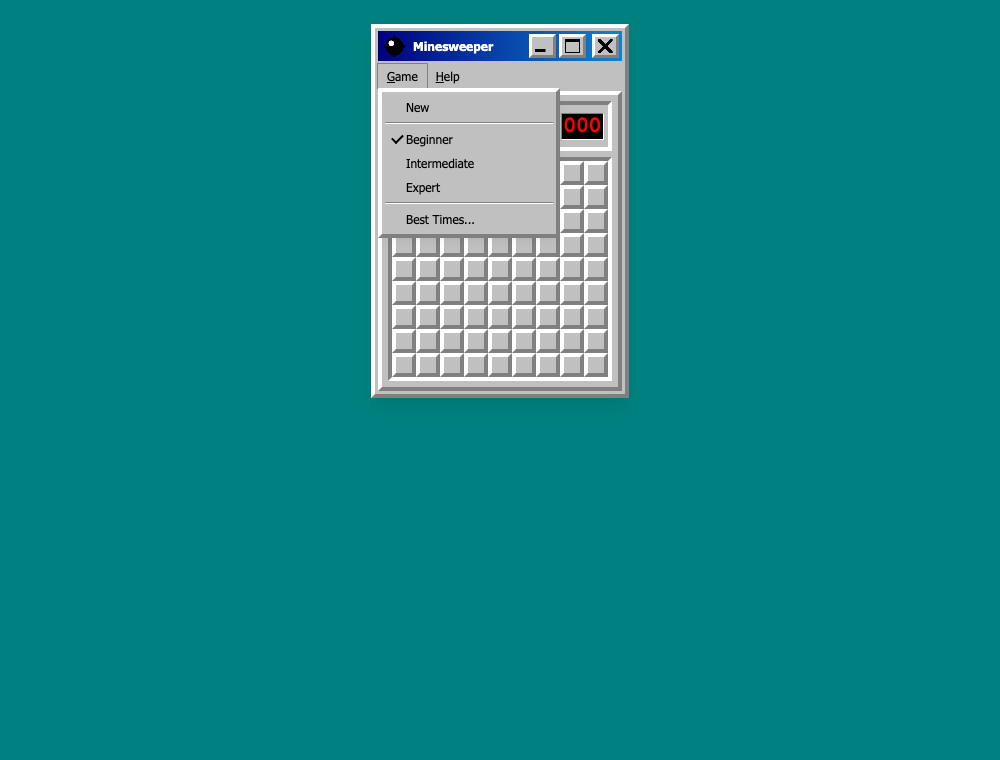
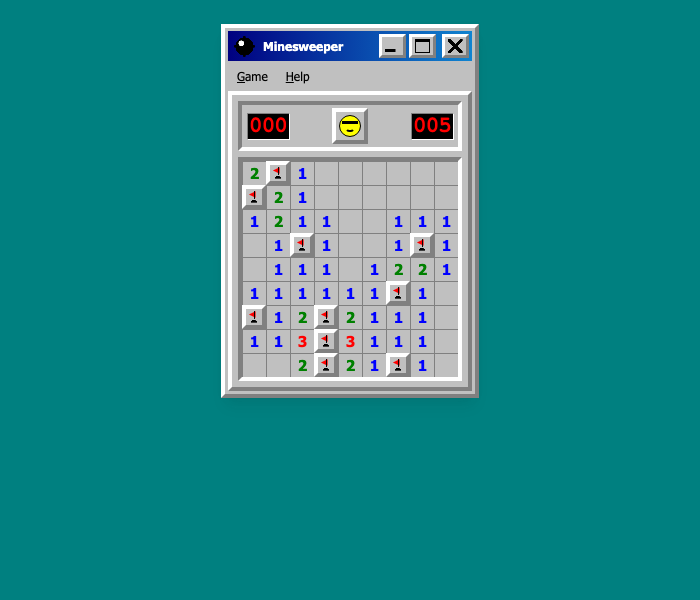
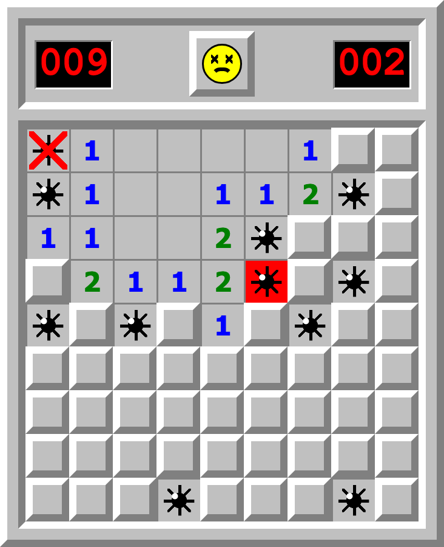
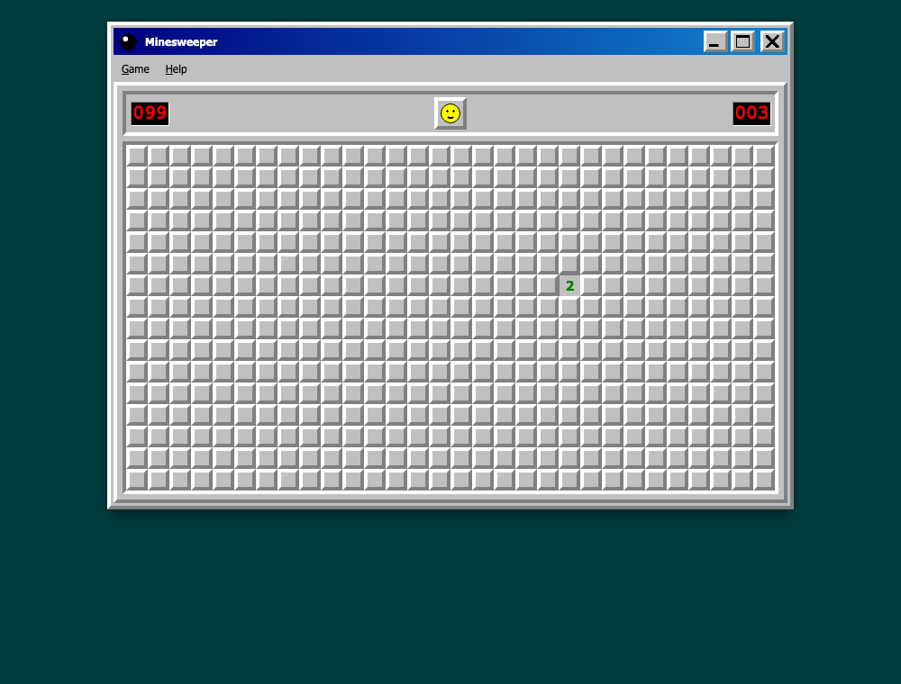

# Minesweeper — journal

**What the app is now:** Minesweeper as it shipped with Windows, written in
pronto. It has a grey window with a navy title bar, Game and Help menus, red
LED counters on either side of the face, and Beginner (9×9, 10 mines),
Intermediate (16×16, 40) and Expert (30×16, 99) as three routes. Best Times
are kept in this browser.

## Turn 1 — 2026-10-16: from an empty directory to a playable game

**Before:** nothing. The project was bootstrapped with pronto 0.13.4 and sayt
0.44.1.

**After:** `generate`, `lint` and `test` all exit 0. `lint` reports no
warnings. The battery ran `sweep`, `clock` and `bump` for 100 generated runs
each and found nothing. The 11 unit tests in `tests/sweep.test.ts` pass.
`integrate` needs Docker, so it was run later in the turn, once Docker
(Colima) was installed; see below.

Playing the built bundle (`sayt release@pages --snapshot`) in headless
Chrome:

| | |
|---|---|
|  |  |
| The Game menu: New, the three levels with the current one checked, Best Times. | A win (seed 4, solved by a script using flags and chords): every mine flagged, counter 000, sunglasses. The 5 s record survived a reload. |
|  |  |
| A loss: the mine that went off on red, the other mines shown, the wrong flag crossed out, the face dead. | Expert in the dark appearance: the window stays as it was and only the desktop darkens. |

Playing found bugs that every gate had passed:

- **The first click did nothing.** When the terminal re-wakes a reduce with a
  draw, the event carries no row id. `sweep` now takes the square from
  `with`, and the unit test's fake re-wake now sends exactly what the
  terminal sends.
- **The face didn't reset after a loss.** A click inside a slot region
  carries no id either; the row is the slot's single item.
- **The counter jumped from 009 to 010 on a loss.** A crossed-out flag still
  counts as a flag.
- **Best Times left the Game menu open** (shown in
  `journal/best-times-before-fix.png`). The two dialogs are now modal
  `<dialog>`s opened with `command="show-modal"`, which closes the menu.
- **The terminal's nav strip duplicated the Game menu.** It is now off
  (`strip: false`).
- **The flag and the smile were too small to read.** Both have been
  redrawn larger.

**Left open:** the original's F2 shortcut and name entry for a record, both
listed as out of scope in the brief.

### Integrate, with Docker

The first `./saytw integrate` failed with 196 `critical` visual-lint
findings, all of them Expert at phone width. The 30-column field is wider
than a phone, and the window was centred with `justify-content: center`,
which pushes an over-wide box past the left edge, where no scroll can reach
it. On a phone, the Game menu and the left columns were unreachable. The
earlier headless checks ran at 900–1000 px and never saw it.

The fix is `justify-content: safe center`: centred while the window fits,
start-aligned and scrollable when it doesn't. At 390 px the Game menu is now
at x = 23 and the field scrolls across 794 px
(`journal/phone-expert.png`). The second `./saytw integrate` **exits 0**.
It reports 10 findings, all `minor`. The ones I read say the page is mostly
empty desktop, which is the intended look.

## Turn 2 — 2026-10-16: the right button belongs to the game

**Before:** in v0.1.0, right-clicking a square flagged it **and** opened the
browser's context menu. In omnishell 0.11.0 the terminal cancels a
`contextmenu` default only for a machine (`data-machine`) that has an arrow
for it. A reduce, such as `data-on-contextmenu="sweep"` on the squares, never
cancels it. Headless Chrome draws no menu, so no earlier check could see
this.

**After:** a one-row `tab` entity, `RightButton`, carries a one-state chart
around the window and its dialogs. Its only arrow is `contextmenu`, so the
terminal cancels the browser menu anywhere in the game; `sweep` still does
the flagging. In the built app, real right-clicks on a square, the face, the
title bar and a counter now all report `defaultPrevented: true`. On the live
v0.1.0 site all of them reported `false`. Flagging and opening work as
before. `generate`, `lint`, `test` and `integrate` exit 0.

## Turn 3 — 2026-10-16: a Hall of Fame every player shares

**Asked for:** Google sign-in through Firebase, and the names added to a
ranking. **Built instead:** guest sign-in, with a typed name per post.
Pronto's terminal offers passkey and guest sign-in only (Firebase is its
*planned* third mode, still absent in omnishell 0.12.1), and pronto refuses a
program that demands a mode the terminal lacks. Cloudflare, the free host
that can run a shared ranking, signs in guests only.

**After:** a won game shows the original's "type your name" box under the
field (`journal/post-box.png`). OK posts the time as a `Score` row, a public
`server` table any guest may insert into under their own id and nobody may
edit. The Game menu opens a Hall of Fame with the ten fastest wins per level
(`journal/hall-of-fame.png`). The release target moved from `pages` to
`cloudflare`, and the app is now named `prontoweeper`.

Checked against the real container cluster (`sayt launch`): a player won,
posted "Ada", and a second player in a separate session saw "1 Ada 4". Through
the HTTP API, posting under another player's id was refused (403), editing or
deleting another's row touched nothing, posting with no session was refused
(401), and posting the same game twice was refused (409, `uq_score_round`).
`generate`, `lint`, `test` and `integrate` exit 0.

Upstream issues found in pronto 0.13.4, each worked around in a file that says
how to remove it:

- The emitted `001_roles.sql` dropped the `electric` role's password, so the
  sync service could never log in once the app had server tables.
  `services/database/sql/010_electric_login.sql` restores it.
- `.goreleaser.yaml` is emitted only for the `pages` target, but every
  target's release needs it. It is now hand-written.
