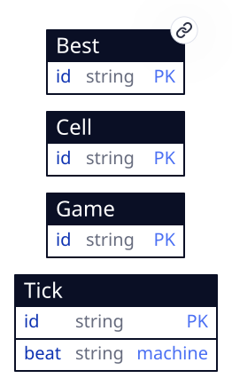
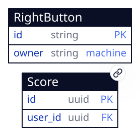

<!-- generated by pronto from ir.html: do not edit, edit ir.html -->

# Minesweeper — IR

Four `tab` entities, one `device` entity and two `server` entities, read and written by three level screens and a Hall of Fame. The field, the games, the clock and the right button are `tab`: they are machine-checked and owe this document nothing. `Best` is `device`, so a record survives a reload; `Score` and `AppUser` are `server`, the cluster every player shares. Those three are described here.

## Overview

Every square of every level is a `Cell` row whose id is its name — `b0305` is Beginner's row 3, column 5 — so a click carries the square it landed on. One reduce, `sweep`, plays every gesture: a left click opens, a right click (`data-on-contextmenu`, which the terminal cancels so no browser menu opens) cycles flag → question mark → raised, a click on an opened number chords, and a click on the face or on New resets the level. It rebuilds the level's field from its rows, plays the gesture, and writes back only the squares and game columns that changed.

The first click on a fresh field returns `then: {seed: true}`: the terminal draws a `uint32` and re-wakes `sweep` with it, and the mines are laid from that draw anywhere but the clicked square. `?seed=` replays the same field.

Time is a `Tick` row advanced by a one-state machine every second on the terminal's clock (`?clock=manual` holds it). The `clock` fold hears each beat and sets each game being played to the seconds since its first click, capped at 999, writing only a timer that moved.

The right button is the game's. The terminal cancels a `contextmenu` default only where a chart draws an arrow for it, and a reduce never does, so a one-row `RightButton` carries a one-state chart around the window and its dialogs whose only arrow is `contextmenu`. The browser's menu never opens over the game; flagging stays `sweep`'s.

## Entities

<a id="Best"></a>
<!-- entity -->

### Best

**durability** device · **access** — · **id** 0xda7be0dea7ec91f6 · **level** ephemeral · **delivery** exactly-once  — 4 fields · 0 referrers

**fields**: id*pk*, level, time, who

<details><summary>all fields, with their metadata</summary>

|  |  |  |  |  |
| --- | --- | --- | --- | --- |
| 1 | id | string | pk | this in ['b', 'i', 'e'] |
| 2 | level | string |  | this in ['beginner', 'intermediate', 'expert'] |
| 3 | time | int32 |  | this >= 0 && this <= 999 |
| 4 | who | string |  | this.size() >= 1 && this.size() <= 32 |

the first column is the field's ordinal, which a diff keys on · pk primary key · → references · ◇ unique · ≡ indexed · ○ nullable · a rule or default in the last column

</details>

<details><summary>the authored table</summary>

</details>

<details><summary>the entity, as JSON</summary>

```
name: "Best"
ir: "Best"
table: "best"
id: "0xda7be0dea7ec91f6"
fields [4]
  0 id
    name: "id"
    ordinal: 1
    retired: false
    type: "string"
    pk: true
    required: true
    cel: "this in ['b', 'i', 'e']"
  1 level
    name: "level"
    ordinal: 2
    retired: false
    type: "string"
    pk: false
    required: true
    cel: "this in ['beginner', 'intermediate', 'expert']"
  2 time
    name: "time"
    ordinal: 3
    retired: false
    type: "int32"
    pk: false
    required: true
    cel: "this >= 0 && this <= 999"
  3 who
    name: "who"
    ordinal: 4
    retired: false
    type: "string"
    pk: false
    required: true
    cel: "this.size() >= 1 && this.size() <= 32"
seed [0]
durability: "device"
level: "ephemeral"
server: false
writers [0]
cel {3}
  checks {0}
  enums {2}
    id [3]
      0: "b"
      1: "i"
      2: "e"
    level [3]
      0: "beginner"
      1: "intermediate"
      2: "expert"
  bounds {2}
    time {2}
      intMin: 0
      intMax: 999
    who {2}
      sizeMin: 1
      sizeMax: 32
uniques [0]
validations {0}
```

</details>

**referenced by**: —

**refers to**: —

**validations**: none

**derived**: **writers** — · **read** — · **roles** anon · app_user · service · **ir** required

<details><summary>the platform’s columns</summary>

`created_by`, `updated_by` → app_user, stamped by the platform on every write; not the author’s.

</details>

The fastest win at each level, at most one row per level. It is the player's own record, so the program seeds none: `sweep` puts the row on the first win at a level and patches `time` when a later win beats it; nothing else writes it. Until a row exists, each Best Times line binds a `data-empty-row` reading 999 seconds by "Anonymous", as the original's did.

| Field | Type | Constraint |
| --- | --- | --- |
| id | string | `this in ['b', 'i', 'e']` |
| level | string | `this in ['beginner', 'intermediate', 'expert']` |
| time | int32 | `this >= 0 && this <= 999` |
| who | string | `this.size() >= 1 && this.size() <= 32` |

<a id="Score"></a>
<!-- entity -->

### Score

**durability** server · **access** public · **id** 0xec8f14b4320f217c · **level** replicated · **delivery** exactly-once  — 7 fields · 0 referrers

**fields**: id*pk*, user_id*→*, level, time, name, round, created

<details><summary>all fields, with their metadata</summary>

|  |  |  |  |  |
| --- | --- | --- | --- | --- |
| 1 | id | uuid | pk |  |
| 2 | user_id | uuid | [→ app_user](#AppUser) | = auth_uid() |
| 3 | level | string |  | this in ['b', 'i', 'e'] |
| 4 | time | int32 |  | this >= 1 && this <= 999 |
| 5 | name | string |  | this.size() >= 1 && this.size() <= 20 |
| 6 | round | string |  | this.matches('^[0-9]{1,10}$') |
| 7 | created | timestamp |  | = now() |

the first column is the field's ordinal, which a diff keys on · pk primary key · → references · ◇ unique · ≡ indexed · ○ nullable · a rule or default in the last column

</details>

<details><summary>the authored table</summary>

</details>

<details><summary>the entity, as JSON</summary>

```
access {1}
  scope: "public"
name: "Score"
ir: "Score"
read: "lazy"
table: "score"
id: "0xec8f14b4320f217c"
fields [7]
  0 id
    name: "id"
    ordinal: 1
    retired: false
    type: "uuid"
    pk: true
    required: true
  1 user_id
    name: "user_id"
    ordinal: 2
    retired: false
    type: "uuid"
    pk: false
    required: true
    ref: "app_user"
    default: "auth_uid()"
  2 level
    name: "level"
    ordinal: 3
    retired: false
    type: "string"
    pk: false
    required: true
    cel: "this in ['b', 'i', 'e']"
  3 time
    name: "time"
    ordinal: 4
    retired: false
    type: "int32"
    pk: false
    required: true
    cel: "this >= 1 && this <= 999"
  4 name
    name: "name"
    ordinal: 5
    retired: false
    type: "string"
    pk: false
    required: true
    cel: "this.size() >= 1 && this.size() <= 20"
  5 round
    name: "round"
    ordinal: 6
    retired: false
    type: "string"
    pk: false
    required: true
    cel: "this.matches('^[0-9]{1,10}$')"
  6 created
    name: "created"
    ordinal: 7
    retired: false
    type: "timestamp"
    pk: false
    required: true
    default: "now()"
seed [0]
durability: "server"
level: "replicated"
server: true
writers [3]
  0 {3}
    by: "beginner"
    kind: "screen"
    ops [1]
      0: "create"
  1 {3}
    by: "intermediate"
    kind: "screen"
    ops [1]
      0: "create"
  2 {3}
    by: "expert"
    kind: "screen"
    ops [1]
      0: "create"
cel {3}
  checks char_length(name) >= 1 AND char_length(name) <= 20
    level: "level IN ('b', 'i', 'e')"
    time: "time >= 1 AND time <= 999"
    name: "char_length(name) >= 1 AND char_length(name) <= 20"
    round: "round ~ '^[0-9]{1,10}$'"
  enums {1}
    level [3]
      0: "b"
      1: "i"
      2: "e"
  bounds {3}
    time {2}
      intMin: 1
      intMax: 999
    name {2}
      sizeMin: 1
      sizeMax: 20
    round {1}
      regex: "^[0-9]{1,10}$"
uniques [1]
  0 uq_score_round
    name: "uq_score_round"
    cols [2]
      0: "user_id"
      1: "round"
validations {0}
```

</details>

**referenced by**: —

**refers to**: [app_user via user_id](#AppUser)

**validations**: none

**derived**: **writers** screen:beginner create, screen:intermediate create, screen:expert create · **read** lazy · **roles** anon · app_user · service · **ir** required

<details><summary>the platform’s columns</summary>

`created_by`, `updated_by` → app_user, stamped by the platform on every write; not the author’s.

</details>

One posted win, in the Hall of Fame every player shares. Anyone reads it, signed in or not; a player inserts only rows whose `user_id` is their own (`auth_uid()`, the column's default) and changes none. That is [decision-score-writes](#decision-score-writes). The `(user_id, round)` unique makes a repeated submit of one game's win the same row, never a second one.

A level screen's post form creates it from the won game's row: `level` is the game's id, `time` its timer, `round` the draw its field was laid from, and `name` what the player typed. The time is the client's word: a player who writes to `/crud` by hand can post any time from 1 to 999, which a homage with nothing at stake accepts.

| Field | Type | Constraint |
| --- | --- | --- |
| id | uuid | minted by the create form |
| user_id | uuid → app_user | default `auth_uid()` |
| level | string | `this in ['b', 'i', 'e']` |
| time | int32 | `this >= 1 && this <= 999` |
| name | string | `this.size() >= 1 && this.size() <= 20` |
| round | string | `this.matches('^[0-9]{1,10}$')` |
| created | timestamp | default `now()` |

<a id="AppUser"></a>
<!-- entity -->

### AppUser

**durability** server · **access** internal · **id** 0xcf5431bbdd3c2cc3 · **level** replicated · **delivery** exactly-once  — 2 fields · 1 referrers

**fields**: id*pk*, handle

<details><summary>all fields, with their metadata</summary>

|  |  |  |  |  |
| --- | --- | --- | --- | --- |
| 1 | id | uuid | pk |  |
| 2 | handle | string | ◇ | this.size() > 0 |

the first column is the field's ordinal, which a diff keys on · pk primary key · → references · ◇ unique · ≡ indexed · ○ nullable · a rule or default in the last column

</details>

<details><summary>the authored table</summary>

</details>

<details><summary>the entity, as JSON</summary>

```
access {1}
  scope: "internal"
name: "AppUser"
ir: "AppUser"
read: "eager"
table: "app_user"
id: "0xcf5431bbdd3c2cc3"
fields [2]
  0 id
    name: "id"
    ordinal: 1
    retired: false
    type: "uuid"
    pk: true
    required: true
  1 handle
    name: "handle"
    ordinal: 2
    retired: false
    type: "string"
    pk: false
    required: true
    unique: true
    cel: "this.size() > 0"
seed [0]
durability: "server"
level: "replicated"
server: true
writers [0]
cel {3}
  checks {1}
    handle: "char_length(handle) > 0"
  enums {0}
  bounds {1}
    handle {1}
      sizeMin: 1
uniques [0]
validations {0}
```

</details>

**referenced by**: [score.user_id](#Score)

**refers to**: —

**validations**: none

**derived**: **writers** — · **read** eager · **roles** anon · app_user · service · **ir** required

<details><summary>the platform’s columns</summary>

`created_by`, `updated_by` → app_user, stamped by the platform on every write; not the author’s.

</details>

The cluster's identities. The auth service inserts a guest's `(id, handle)` when the terminal signs one in at boot. Nothing in the app reads it, so its access is `internal`; a score names its player by the name they typed, never by the handle.

| Field | Type | Constraint |
| --- | --- | --- |
| id | uuid | supplied by the auth service |
| handle | string | unique, `this.size() > 0` |

## Screens

The three screens are the same window over different rows: the cells whose `lv` is the level, and the game whose id is. Each holds `keep: 0`, so only the level on screen runs a metronome.

<details><summary>App entity neighbourhood · 6 entities</summary>


**entities:** [Best](#Best), Cell, Game, RightButton, [Score](#Score), Tick

</details>

<a id="beginner"></a>
<!-- screen -->

### Beginner (/)


***entities:** [Best](#Best), Cell, Game, RightButton, [Score](#Score), Tick*

9 × 9 squares, 10 mines. The Game menu links the three levels, marking this one current, and opens Best Times; Help opens About.

<a id="beginner-populated"></a>
<!-- state of beginner -->

*010 · ☺ · 000 over a raised 9 × 9 field* (drawn in [ir.html](ir.html#beginner-populated))

*paths of beginner:*

```json
{
  "play": {
    "states": [
      "populated",
      "populated"
    ],
    "accepts": [
      "accept-ready",
      "accept-first-click",
      "accept-numbers",
      "accept-flag",
      "accept-chord",
      "accept-timer",
      "accept-lose",
      "accept-win",
      "accept-new-game"
    ]
  },
  "post": {
    "states": [
      "populated",
      "populated"
    ],
    "accepts": [
      "accept-post-score"
    ]
  },
  "records": {
    "states": [
      "populated",
      "populated"
    ],
    "accepts": [
      "accept-best-times",
      "accept-levels"
    ]
  }
}
```

<a id="intermediate"></a>
<!-- screen -->

### Intermediate (/intermediate)


***entities:** [Best](#Best), Cell, Game, RightButton, [Score](#Score), Tick*

16 × 16 squares, 40 mines; the same window.

<a id="intermediate-populated"></a>
<!-- state of intermediate -->

*040 · ☺ · 000 over a raised 16 × 16 field* (drawn in [ir.html](ir.html#intermediate-populated))

*paths of intermediate:*

```json
{
  "play": {
    "states": [
      "populated",
      "populated"
    ],
    "accepts": [
      "accept-levels"
    ]
  }
}
```

<a id="expert"></a>
<!-- screen -->

### Expert (/expert)



***entities:** [Best](#Best), Cell, Game, RightButton, [Score](#Score), Tick*

30 × 16 squares, 99 mines; the same window, wider.

<a id="expert-populated"></a>
<!-- state of expert -->

*099 · ☺ · 000 over a raised 30 × 16 field* (drawn in [ir.html](ir.html#expert-populated))

*paths of expert:*

```json
{
  "play": {
    "states": [
      "populated",
      "populated"
    ],
    "accepts": [
      "accept-levels"
    ]
  }
}
```

<a id="halloffame"></a>
<!-- screen -->

### Hall of Fame (/hall-of-fame)



***entities:** RightButton, [Score](#Score)*

Three boards, one per level: the ten fastest posted wins, by `time` and then by who posted first, each numbered by its place (`data-project` `index`). The menu bar leads back to each level. Reached from the Game menu's Hall of Fame item and from the note a posted win leaves.

<a id="halloffame-populated"></a>
<!-- state of halloffame -->

*Three boards of names and seconds; a level with none says "No times yet."* (drawn in [ir.html](ir.html#halloffame-populated))

*paths of halloffame:*

```json
{
  "browse": {
    "states": [
      "populated",
      "populated"
    ],
    "accepts": [
      "accept-hall-of-fame"
    ]
  }
}
```

## Invariants

A fresh field is laid so the first square is safe: after the draw, `output.cell[input.first].mine == 'no'` and exactly `game.mines` cells of the level carry `mine == 'yes'`. Each cell's `n` is the count of its up-to-eight neighbours with a mine.

The counter is `game.left == game.mines - size(flags)`, written as `left_led`: three digits, or a minus and two when negative.

The game is won exactly when every cell with `mine == 'no'` has `look == 'open'`; it is lost when a cell with a mine is opened, which becomes `boom`. A won or lost game ignores every square until reset.

A won game's post panel shows its form until a score with that game's `round` exists, then a note instead: `size(score.filter(s, s.round == game.round)) > 0` hides the form. The unique on `(user_id, round)` holds the same on the server.

## Decisions

<a id="decision-escape-hatches"></a>
<!-- decision -->

**Escape hatches: none.** No container, WASM unit, vendored component or external endpoint; every line of app code is a handler the terminal runs in a compartment.

<a id="decision-guests"></a>
<!-- decision -->

**Sign-in: guests, minted silently.** The brief asked for Google sign-in through Firebase. The terminal offers passkey and guest and nothing else (Firebase is its planned third mode), and pronto refuses a program that demands a mode the terminal lacks. The edge tier, where this app is released, signs in guests only: passkeys need the auth service's ceremonies, which the edge does not run. So `auth.required` is false, the terminal mints a guest at boot, and a guest's session lives as long as the tab. A winner types a name with each post, as the original's record box asked for one.

<a id="decision-score-writes"></a>
<!-- decision -->

**Score: everyone reads, the owner inserts.** `#Access` has no such mode, so `Score` is declared `public` and `011_score_writes.sql` adds one permissive INSERT arm, `WITH CHECK (user_id = auth_uid())`, as realworld's owner writes do. There is no UPDATE and no DELETE arm. Declaring it `private` and widening SELECT in SQL would make the browser believe "mine" where the server means "everyone's".

<a id="decision-hosting"></a>
<!-- decision -->

**Released to Cloudflare, not Pages.** A ranking every player shares needs a cluster every player reaches. The Pages target runs a whole cluster inside each tab, so its Hall of Fame would hold one player's wins. The edge target runs one cluster in a Durable Object behind a Worker, and serves guests.

<a id="decision-durability"></a>
<!-- decision -->

**Durability: the game is `tab`, the records `device`.** A game in progress lives as long as the tab, as it did in the original's window; only Best Times was ever kept, and here it survives a reload in this browser. Levels are three routes rather than a resize of one field: each level keeps its own rows and its own game, the field is seeded by CUE for all three, and no reduce ever has to add or remove squares.

<a id="Subscription"></a>
<!-- entity -->

### Subscription

**durability** live · **access** private · owner owner_id · **id** 0x8c41a02eca805674 · **level** compensable · **delivery** at-most-once  — 6 fields · 0 referrers

**fields**: id*pk*, plan, active, through, ver, owner_id

<details><summary>all fields, with their metadata</summary>

|  |  |  |  |  |
| --- | --- | --- | --- | --- |
| 1 | id | text | pk | this.size() <= 80 |
| 2 | plan | text |  | this.size() <= 32 |
| 3 | active | bool |  |  |
| 4 | through | timestamp |  |  |
| 5 | ver | int64 |  | this >= 0 |
| 6 | owner_id | uuid |  | = auth_uid() |

the first column is the field's ordinal, which a diff keys on · pk primary key · → references · ◇ unique · ≡ indexed · ○ nullable · a rule or default in the last column

</details>

<details><summary>the authored table</summary>

</details>

<details><summary>the entity, as JSON</summary>

```
name: "Subscription"
ir: "Subscription"
read: "eager"
table: "subscription"
id: "0x8c41a02eca805674"
access {2}
  scope: "private"
  owner: "owner_id"
durability: "live"
fields [6]
  0 id
    name: "id"
    ordinal: 1
    retired: false
    type: "text"
    pk: true
    required: true
    cel: "this.size() <= 80"
  1 plan
    name: "plan"
    ordinal: 2
    retired: false
    type: "text"
    pk: false
    required: true
    cel: "this.size() <= 32"
  2 active
    name: "active"
    ordinal: 3
    retired: false
    type: "bool"
    pk: false
    required: true
  3 through
    name: "through"
    ordinal: 4
    retired: false
    type: "timestamp"
    pk: false
    required: true
  4 ver
    name: "ver"
    ordinal: 5
    retired: false
    type: "int64"
    pk: false
    required: true
    cel: "this >= 0"
  5 owner_id
    name: "owner_id"
    ordinal: 6
    retired: false
    type: "uuid"
    pk: false
    required: true
    default: "auth_uid()"
seed [0]
level: "compensable"
server: true
writers [0]
cel {3}
  checks {3}
    id: "char_length(id) <= 80"
    plan: "char_length(plan) <= 32"
    ver: "ver >= 0"
  enums {0}
  bounds {3}
    id {1}
      sizeMax: 80
    plan {1}
      sizeMax: 32
    ver {1}
      intMin: 0
uniques [0]
validations {0}
```

</details>

**referenced by**: —

**refers to**: —

**validations**: none

**derived**: **writers** — · **read** eager · **roles** anon · app_user · service · **ir** required

<details><summary>the platform’s columns</summary>

`created_by`, `updated_by` → app_user, stamped by the platform on every write; not the author’s.

</details>

Each plan an account holds, and until when: the billing broker's word, which only the database writes (pronto-billing's migration); the account reads its own, and a paid feature's gate reads it.

<a id="billing"></a>
<!-- hatch -->

### billing — the billing service (container, pronto-billing)

Beside the door, behind `/billing/*` and `/.well-known/pronto-billing.json`: publishes the plans and the hash of the author's payout secret, takes the operator's billing broker's signed entitlements into `Subscription`, and sends a signed-in account to Stripe to subscribe or to manage its subscription. It holds no secret. Added by `connect stripe`.
